<!-- Animated Neon Arcade Header -->

  

<!-- Animated Pixel Intro Text -->

  

<!-- Animated Pac-Man Chasing Ghosts Ticker -->

  

<!-- HUD Status Bar -->

  
  
  
  

 

<!-- ==================== STAGE 1: PAC-MAN ==================== -->

  

  

  <picture>
    <source media="(prefers-color-scheme: dark)" srcset="https://raw.githubusercontent.com/HizbullahHasanIbrahim/HizbullahHasanIbrahim/output/pacman-contribution-graph-dark.svg" />
    <source media="(prefers-color-scheme: light)" srcset="https://raw.githubusercontent.com/HizbullahHasanIbrahim/HizbullahHasanIbrahim/output/pacman-contribution-graph.svg" />
    
  </picture>

 

<!-- ==================== STAGE 2: CYBER SNAKE ==================== -->

  

  

  <picture>
    <source media="(prefers-color-scheme: dark)" srcset="https://raw.githubusercontent.com/HizbullahHasanIbrahim/HizbullahHasanIbrahim/output/github-contribution-grid-snake-dark.svg" />
    <source media="(prefers-color-scheme: light)" srcset="https://raw.githubusercontent.com/HizbullahHasanIbrahim/HizbullahHasanIbrahim/output/github-contribution-grid-snake.svg" />
    
  </picture>

 

<!-- ==================== STAGE 3: INTERACTIVE BOSS BATTLE ==================== -->

  

<!-- Live Animated Battle Screen -->

  

  

   
  

 

  

   
  

 

  

   
  

 

<!-- ==================== STAGE 4: MYSTERY GACHA CAPSULES ==================== -->

  

  

  

   
  

 

  

   
  

 

  

   
  

 

<!-- ==================== STAGE 5: LIVE ARCADE HUMOR ==================== -->

  

 

  

 

<!-- Animated Neon Footer -->

  

